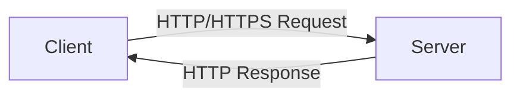
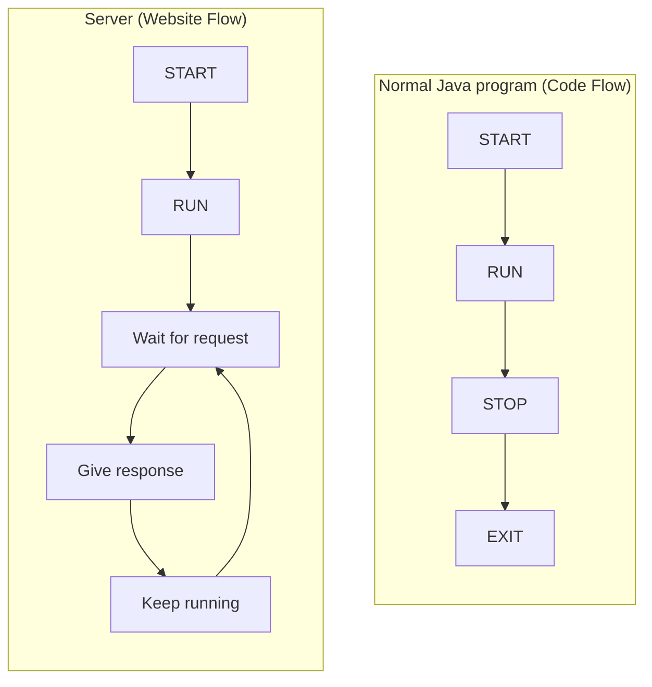
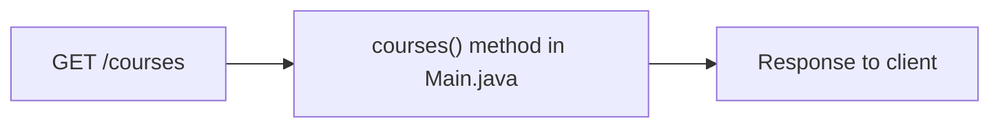
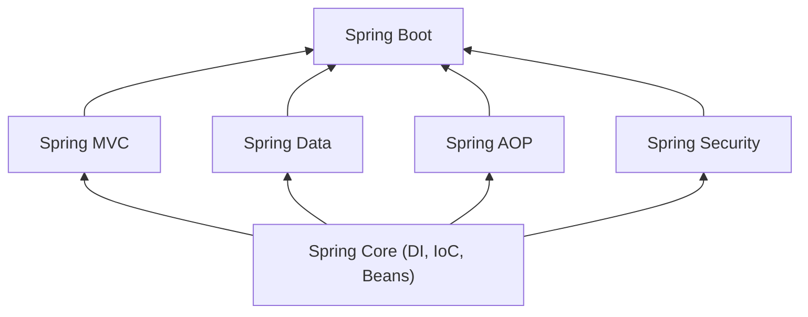
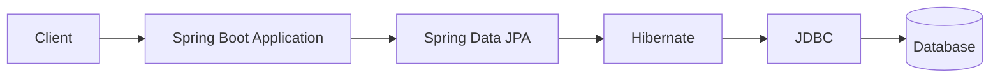

# Spring Lecture 1: Introduction

> [!abstract] What this lecture covers
> Client and server, normal code vs server flow, how Java talks over a network, HTTP request and response, and the big picture of the Spring ecosystem.

---

## 1. Client and Server

- **Client** = the one who **asks** (sends a request)
- **Server** = the one who **responds** (sends a response)
- They talk using **HTTP / HTTPS**



**Examples of clients:**
- Browser
- Mobile app (Android / iOS)
- React frontend
- Postman (a tool to test APIs)
- Even another server

> [!note]
> The server works with data (entities like users or courses) and sends the result back to the client.

---

## 2. Normal Code Flow vs Server Flow



> [!important]
> A normal program runs top to bottom and **exits**. A server **never exits** after one task. It keeps waiting for the next request.

---

## 3. How Java Talks Over a Network (`java.net`)

Java has a package called `java.net` for networking. It has two main classes:

| Class | Used by |
|---|---|
| `Socket` | Client side |
| `ServerSocket` | Server side |

```java
ServerSocket server = new ServerSocket(8080);
```

This makes the server **listen on port 8080**.

**Why ports?**
Many apps run on one computer (WhatsApp, Chrome, Spotify). Each app uses its own **port number** so the data reaches the right app.

> [!tip] Why we learn Spring
> Writing all this socket code by hand is long and difficult. Spring does the hard work for us.

---

## 4. HTTP Request

**HTTP** = the set of rules the client and server use to talk.

A request has **4 parts**:

1. **Method name**: GET, POST, etc.
2. **URL / Path**: `/courses`, `/login`
3. **Headers**: extra information about the request
4. **Body**: the data being sent

**Example 1: GET request (asking for data)**
```http
GET /courses
Host: www.codersarmy.in
```

**Example 2: POST request (sending data)**
```http
POST /login
Host: www.codersarmy.in
Content-Type: application/json

{
  "email": "...",
  "password": "..."
}
```

**Header example**
```http
Accept: application/json
```
This means: "I want the response in JSON format."

> [!note] GET vs POST (simple idea)
> - **GET**: just asking for data, usually no body
> - **POST**: sending data to the server, so it has a body

---

## 5. How the Server Handles a Request

The **path** in the request is matched with a **method** in our Java code. That method runs, and its result goes back to the client.



> [!tip]
> Spring does this path-to-method mapping for us.

---

## 6. HTTP Response

A response has **3 parts**:

1. **Status code**: e.g. `200 OK`
2. **Headers**
3. **Body**

**Example**
```http
200 OK
Content-Type: application/json

{
  "message": "login successful"
}
```

---

## 7. Spring Framework: Big Picture



| Module | What it does |
|---|---|
| **Spring Core** | Base of everything. Contains DI, IoC, Beans |
| **Spring MVC** | Build web apps and REST APIs |
| **Spring Data** | Work with databases |
| **Spring AOP** | Common tasks like logging (Aspect Oriented Programming) |
| **Spring Security** | Login, authentication, protection |
| **Spring Boot** | Sits on top and makes everything easy (less setup, ready-made configuration) |

---

## 8. Typical Spring Boot App Flow



- **Spring Data JPA**: easy way to talk to the database
- **Hibernate**: converts Java objects to DB tables and back
- **JDBC**: the basic Java way to connect to a database

---

## Quick Revision

- [ ] Client asks, server responds
- [ ] HTTP/HTTPS is the communication protocol
- [ ] A server keeps running and waits for requests
- [ ] Request = Method + URL + Headers + Body
- [ ] Response = Status code + Headers + Body
- [ ] Java has `Socket` and `ServerSocket`, but they are hard to use directly
- [ ] Spring Core is the base, Spring Boot makes it easy

## Next Topics

- [[Dependency Injection (DI)]]
- [[Inversion of Control (IoC)]]
- [[Beans]]
