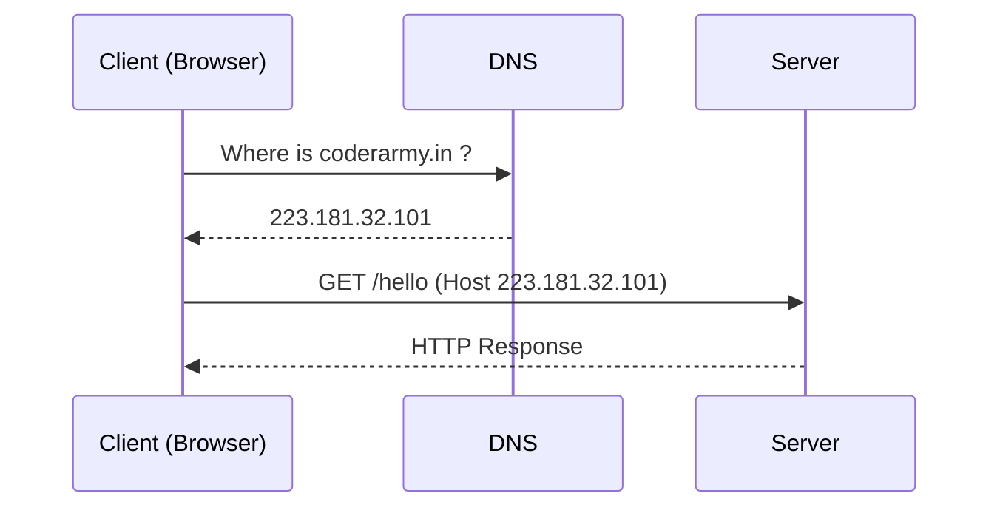
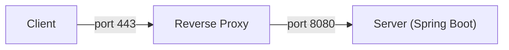
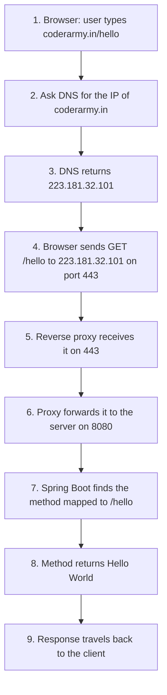
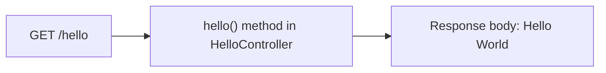

# Spring Lecture 2: DNS, Ports, Reverse Proxy and Our First Spring Boot App

> [!abstract] What this lecture covers
> 1. How a request actually finds the server (IP address and DNS)
> 2. Ports and the standard HTTP / HTTPS ports
> 3. Reverse proxy (why port 443 becomes 8080)
> 4. The complete journey of one request
> 5. Our first Spring Boot application: `DemoApplication`, `HelloController`, `application.properties`

In Lecture 1 we learned that a client sends an HTTP request and a server sends a response. This lecture answers the next questions: **how does the client know where the server is, and how does the request reach our Java code?**

---

## 1. IP Address

### What is it?
An **IP address** is the unique address of a machine on a network. It works like a house address: to send a letter you need the address, and to send a request you need the IP of the server.

Example from the lecture: `223.181.32.101`

### Why not just use the IP?
Humans cannot remember numbers like `223.181.32.101` for every website. We remember names like `coderarmy.in`. Something must convert the name into the number. That something is **DNS**.

> [!note]
> An IP address identifies the **machine**. It does not say which application on that machine should get the request. That is the job of the **port** (section 3).

---

## 2. DNS (Domain Name System)

### What is it?
DNS is like the **phonebook of the internet**. You give it a domain name (`coderarmy.in`) and it gives back the IP address (`223.181.32.101`).

### How it works (step by step)



1. You type `coderarmy.in` in the browser.
2. The client first asks **DNS**: "what is the IP of coderarmy.in?"
3. DNS replies with the IP: `223.181.32.101`.
4. Now the client sends the real HTTP request to that IP.
5. The server sends back the response.

> [!important]
> DNS lookup happens **before** the HTTP request. The HTTP request cannot be sent until the client knows the IP.

### Where does `Host` come in?
In the request, the `Host` header says which server/site the request is meant for:

```http
GET /hello
Host: 223.181.32.101
```

---

## 3. Ports

### What is a port?
One machine runs many programs at the same time (a web server, a database, and so on). The IP gets the request to the machine, but the **port number** tells the machine **which program** should receive it.

**Analogy:** the IP is the building's address, and the port is the flat number inside the building.

### Standard ports to remember

| Protocol | Default port |
|---|---|
| HTTP | **80** |
| HTTPS | **443** |

- If you type a URL without a port, the browser automatically uses 80 (HTTP) or 443 (HTTPS).
- So `https://coderarmy.in` really means `https://coderarmy.in:443`.

### Our Spring Boot server uses 8080
When our Spring Boot app runs on a machine, it listens on port **8080** by default (the same `ServerSocket(8080)` idea from Lecture 1).

### The mismatch
- The outside world (client) sends requests to **443**
- Our Java application listens on **8080**

So who connects the two? A **reverse proxy**.

---

## 4. Reverse Proxy

### What is it?
A **reverse proxy** is a server that sits **in front of** your application server. The client talks to the reverse proxy, and the reverse proxy forwards the request to the real server.



In the lecture's example:

```
GET /hello
Host: 223.181.32.101:443

443 : 8080   <- proxy converts the public port 443 to the app port 8080
```

### Why use one?
- **Port mapping:** public users use the standard port 443, while the app runs on 8080
- **Security:** the real server is hidden behind the proxy and not directly exposed
- **HTTPS handling:** the proxy can take care of HTTPS (certificates) so the app does not have to
- **Load balancing:** it can spread requests across multiple servers
- Popular tools for this: Nginx, Apache

> [!tip] Forward proxy vs reverse proxy (quick idea)
> A forward proxy hides the **client** from the server. A reverse proxy hides the **server** from the client. In this lecture we only need the reverse proxy.

---

## 5. Full Journey of One Request

Putting everything together for the request `https://coderarmy.in/hello`:



---

## 6. Our First Spring Boot Application

Now the code. A basic project (called `demo`, package `com.example.demo`) has these files:

| File | Purpose |
|---|---|
| `DemoApplication.java` | Entry point that starts the app |
| `HelloController.java` | Handles the request for `/hello` |
| `application.properties` | Configuration of the app |

### 6.1 DemoApplication.java (the starting point)

```java
package com.example.demo;

import org.springframework.boot.SpringApplication;
import org.springframework.boot.autoconfigure.SpringBootApplication;

@SpringBootApplication
public class DemoApplication {

    public static void main(String[] args) {
        SpringApplication.run(DemoApplication.class, args);
    }
}
```

**Line by line:**

- `public static void main(String[] args)`: the normal Java entry point. Every Java program starts here.
- `SpringApplication.run(DemoApplication.class, args);`: this one line **starts the whole Spring application**. It:
  - sets up the Spring container (Spring Core)
  - scans your classes and finds the ones Spring should manage
  - starts the built-in web server (this is why we did not install a separate server)
  - makes the app listen for requests (port 8080 by default)
- `@SpringBootApplication`: an **annotation** placed on the main class. It tells Spring: "this is a Spring Boot app, start the setup from here." It combines three things:
  - **@Configuration**: this class can define Spring configuration
  - **@ComponentScan**: scan this package (and its sub-packages) for Spring classes
  - **@EnableAutoConfiguration**: automatically configure things based on what is on the classpath

> [!important] Connect it with Lecture 1
> In Lecture 1 we saw that a server must **start, run, wait for requests and keep running**. `SpringApplication.run(...)` is exactly what makes our program behave like that. The program does not exit after `main` finishes.

> [!note] Package matters
> `@ComponentScan` scans from the package of the main class downwards. Keep your controllers in `com.example.demo` or its sub-packages, otherwise Spring will not find them.

### The commented-out code (what we do NOT write)

In the main method there is commented-out code like this:

```java
// HelloController controller = new HelloController();
// String s = controller.hello();
//
// System.out.println(s);
```

This is how we would normally use a class in plain Java: **create the object ourselves with `new` and call the method ourselves.**

In Spring we do **not** do this. We never write `new HelloController()` and never call `hello()` ourselves. Spring creates the object and calls the method **when a matching request arrives**. This idea (Spring controlling object creation instead of us) is called **IoC (Inversion of Control)**, and it is coming up in the next lectures.

---

### 6.2 HelloController.java (our first API)

```java
package com.example.demo;

import org.springframework.web.bind.annotation.GetMapping;
import org.springframework.web.bind.annotation.RestController;

@RestController
public class HelloController {

    @GetMapping("hello")
    public String hello() {
        return "Hello World";
    }
}
```

**Line by line:**

- `@RestController`: marks this class as a **controller that handles web requests**. Spring will detect it, create its object, and use it to answer HTTP requests. "Rest" means the return values are sent straight back in the response body (as text or JSON), not as a web page template.
- `@GetMapping("hello")`: maps an **HTTP GET request with the path `/hello`** to the method below it.
- `public String hello()`: a normal Java method. Spring calls it when `GET /hello` arrives.
- `return "Hello World";`: this value becomes the **body of the HTTP response**.

### How it connects to Lecture 1



In Lecture 1 we drew "GET /courses maps to the courses() method". `@GetMapping` is **how Spring does that mapping for us**.

| Request part | Where it shows up in the code |
|---|---|
| Method name (GET) | `@GetMapping` |
| URL / Path (`/hello`) | `"hello"` inside `@GetMapping("hello")` |
| Response body | the returned String `"Hello World"` |

### Running and testing
1. Run `DemoApplication` (the green run button in the IDE).
2. Open the browser and go to `http://localhost:8080/hello`.
3. You will see: `Hello World`

> [!note]
> `localhost` means "this same machine", and `8080` is the port our app listens on. Here you are the client and your own computer is the server.

---

### 6.3 application.properties

This file holds **configuration** for the app. It is empty at the start, and Spring Boot uses default values. You will use it later to change settings, for example the port:

```properties
server.port=9090
```

After this the app would run on 9090 instead of 8080.

---

## Quick Revision

- [ ] **IP address** = address of a machine; **DNS** = converts domain name to IP
- [ ] The client asks DNS first, then sends the HTTP request to the IP
- [ ] **Port** = which program on the machine gets the request
- [ ] HTTP = **80**, HTTPS = **443**, Spring Boot default = **8080**
- [ ] **Reverse proxy** sits in front of the server and forwards 443 to 8080
- [ ] `@SpringBootApplication` marks the starting class of a Spring Boot app
- [ ] `SpringApplication.run(...)` starts Spring and the built-in server
- [ ] `@RestController` makes a class handle web requests
- [ ] `@GetMapping("hello")` maps `GET /hello` to a method
- [ ] We never create the controller object ourselves. Spring does it (IoC)
- [ ] `application.properties` is for configuration (e.g. `server.port`)

## Possible Exam / Interview Questions

1. What is DNS and why is it needed?
2. What is the difference between an IP address and a port?
3. What are the default ports of HTTP and HTTPS?
4. What is a reverse proxy and why do we use it?
5. What does `@SpringBootApplication` do?
6. What is the use of `@RestController` and `@GetMapping`?
7. Why don't we create the controller object with `new` in Spring?

## Next Topics

- [[Inversion of Control (IoC)]]
- [[Dependency Injection (DI)]]
- [[Beans]]
