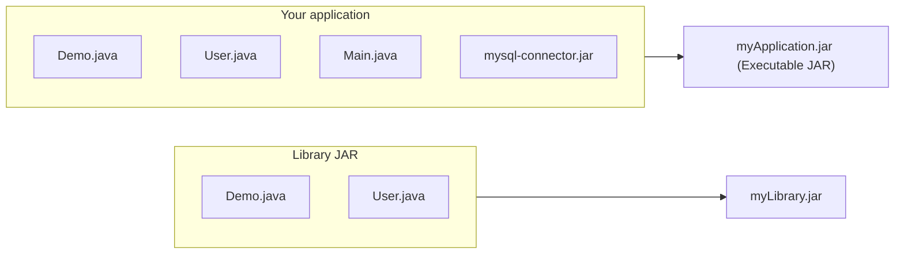
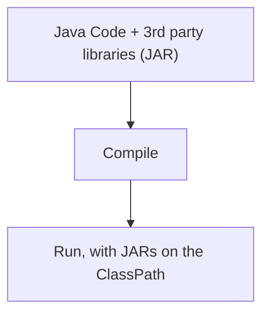
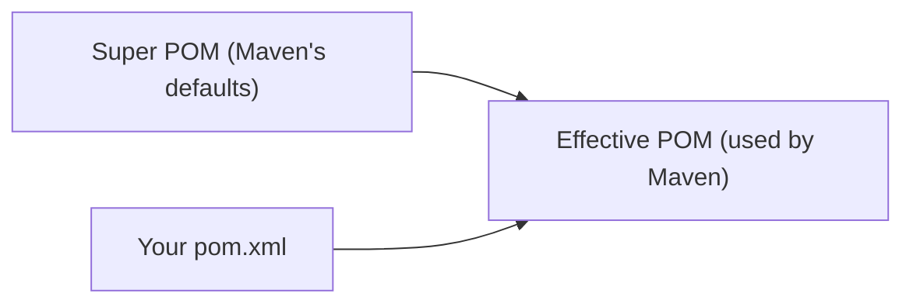
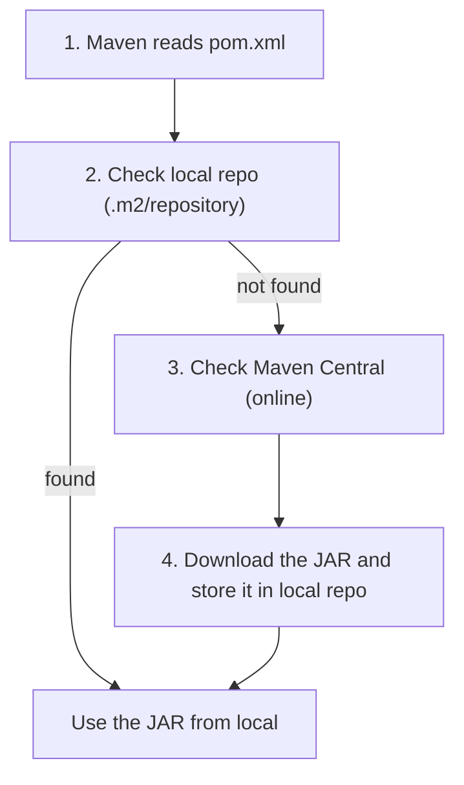
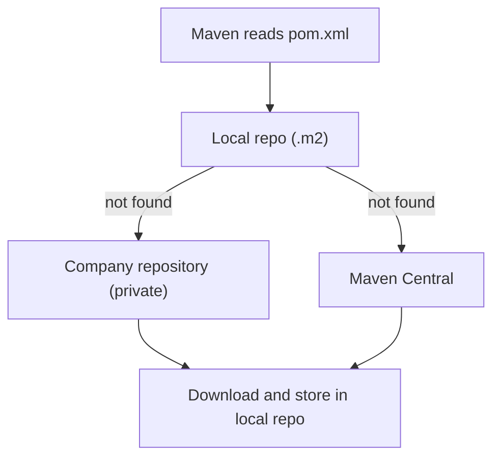
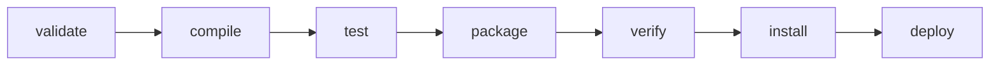

# Spring Lecture 3: JAR, Maven, pom.xml, Repositories, Plugins and Lifecycle

> [!abstract] What this lecture covers
> 1. JAR files (library JAR vs executable JAR) and the classpath
> 2. Why we need Maven (problems of managing JARs by hand)
> 3. What Maven is and the project structure it creates
> 4. `pom.xml`, line by line, and how to add dependencies
> 5. Super POM and Effective POM
> 6. Maven repositories (local, central, remote) and the complete download flow
> 7. How to add a **private / company repository**
> 8. Maven plugins
> 9. Maven lifecycles (clean, default, site)

---

## 1. JAR Files

### Quick recap: how normal Java runs
```
Demo.java  -->  compiler  -->  Demo.class  -->  JVM  -->  output
```
- `.java` = source code you write
- `.class` = compiled bytecode that the JVM understands

### The problem
A real project has many files, not one:

```
Order.java      Order.class
User.java       User.class
Payment.java    Payment.class
...             ...
```
Plus images, properties files and folders (packages). Sharing 100 loose files is messy.

### The solution: JAR
**JAR = Java ARchive.** It is basically a **ZIP file** that packs everything together into one file.

A JAR can contain:
1. Multiple `.class` files
2. Resources (images, `.properties` files)
3. Folders / packages

### Why do we use JARs?
**Reason 1: To share your Java code easily.**
Instead of sending 100 files, you send one file, e.g. `calculator.jar`. A JAR can be one of two kinds:

| Type | What it is | Has `main()`? | Example |
|---|---|---|---|
| **Library JAR** | Reusable code that other projects use | No | `myLibrary.jar`, `mysql-connector.jar` |
| **Application JAR (Executable JAR)** | A complete program you can run | Yes | `myApplication.jar` |

**Reason 2: To use external libraries.**
You do not write everything yourself. Someone else already wrote code to talk to MySQL, so you simply add their JAR (for example `mysql-connector.jar`) to your project and use it.



> [!note]
> An executable JAR is run with `java -jar myApplication.jar`. Spring Boot apps are normally delivered this way.

---

## 2. Classpath

When your code uses 3rd party libraries, the JVM must know **where to find those JARs** while running.



- **Classpath** = the list of places (folders and JAR files) where Java looks for `.class` files.
- If a needed JAR is not on the classpath, you get errors like `ClassNotFoundException`.

---

## 3. Why We Need Maven (the problem)

Suppose you want to use MySQL in your project. Without a tool you must:

1. Go to the website and **download the `mysql-connector` JAR manually**
2. Add it to your project and classpath yourself
3. Repeat this for every library, in every project

This causes three big problems:

| Problem | Meaning |
|---|---|
| **1. Manual effort** | Downloading, copying and adding every JAR by hand is slow and boring |
| **2. Versioning mismatch** | Libraries must work with each other's versions. For example **Spring 7 works with Spring Boot 4**. Mixing wrong versions breaks the project |
| **3. Transitive dependencies** | A library you add may itself need other libraries, and those need others too. You would have to find and download all of them yourself |

> [!example] Transitive dependency example
> You add library **A**. A needs **B**, and B needs **C**. You only asked for A, but you also need B and C. Maven handles this chain automatically.

---

## 4. What is Maven?

**Maven is a Project Management Tool** (also called a build tool). It does these jobs for us:

1. Creates the **folder structure** of the project
2. **Compiles** the code
3. **Creates the JAR** file
4. **Downloads dependencies** (the JARs) automatically

### Maven project structure

```
MavenDemo
 ├── src
 │    ├── main
 │    │    ├── java          <- your Java source code (packages, classes)
 │    │    └── resources     <- images, properties files, etc.
 │    └── test
 │         └── java          <- test code
 ├── target                  <- output folder (created by Maven)
 │    ├── classes            <- compiled .class files
 │    └── generated-sources
 ├── .gitignore
 └── pom.xml                 <- heart of the Maven project
```

| Folder / File | Purpose |
|---|---|
| `src/main/java` | Where you write your application code |
| `src/main/resources` | Config files and other resources |
| `src/test` | Test code |
| `target` | **Generated by Maven.** Holds compiled classes and the final JAR |
| `pom.xml` | Project details and dependencies |

> [!important] About the `target` folder
> You never write code here. Maven creates it when you compile or package. It can be deleted and regenerated at any time (that is what `mvn clean` does). That is why `target` is normally listed in `.gitignore` and not uploaded to Git.

---

## 5. pom.xml

**POM = Project Object Model.** `pom.xml` is an XML file that describes your project to Maven: what the project is, what it depends on, and how to build it.

### A basic pom.xml

```xml
<?xml version="1.0" encoding="UTF-8"?>
<project xmlns="http://maven.apache.org/POM/4.0.0"
         xmlns:xsi="http://www.w3.org/2001/XMLSchema-instance"
         xsi:schemaLocation="http://maven.apache.org/POM/4.0.0 http://maven.apache.org/xsd/maven-4.0.0.xsd">

    <modelVersion>4.0.0</modelVersion>

    <groupId>org.example</groupId>
    <artifactId>MavenDemo</artifactId>
    <version>1.0-SNAPSHOT</version>

    <properties>
        <maven.compiler.source>23</maven.compiler.source>
        <maven.compiler.target>23</maven.compiler.target>
        <project.build.sourceEncoding>UTF-8</project.build.sourceEncoding>
    </properties>

</project>
```

### Part by part

| Tag | Meaning |
|---|---|
| `<project>` | Root tag. The `xmlns` / `schemaLocation` lines tell which XML rules (schema) the file follows. Just keep them as generated |
| `<modelVersion>` | Version of the POM structure itself. It is always `4.0.0` for Maven 2 and 3 (the IDE shows "Compatible with Maven 3") |
| `<groupId>` | Group / organisation / company that owns the project. Usually a reversed domain, e.g. `org.example`, `com.coderarmy` |
| `<artifactId>` | Name of the project (and of the JAR). Here: `MavenDemo` |
| `<version>` | Version of the project. `1.0-SNAPSHOT` means "version 1.0, still under development" |
| `<properties>` | Settings and values used by the project, e.g. Java version 23 for compiling and the file encoding |

### Maven coordinates (GAV)
Every project or library in the Maven world is identified by three values:

```
groupId  +  artifactId  +  version
```
This unique identity is called the **coordinates**. When you add a dependency you are simply telling Maven the coordinates of the JAR you want.

### SNAPSHOT vs release
- `1.0-SNAPSHOT`: work in progress, can change
- `1.0` : a final, fixed release

---

## 6. Adding Dependencies in pom.xml

This is the main use of Maven. Instead of downloading a JAR manually, you write a `<dependency>` and Maven downloads it.

### Steps
1. Find the library on **Maven Central** (search it on `mvnrepository.com` or `central.sonatype.com`). For example, MySQL Connector or Hibernate.
2. Copy its Maven snippet (groupId, artifactId, version).
3. Paste it inside a `<dependencies>` block in `pom.xml`.
4. **Reload Maven** in the IDE (the Maven "m" icon, then "Reload"). Maven downloads the JAR and its transitive dependencies.

### Example: adding the MySQL connector

```xml
<dependencies>

    <dependency>
        <groupId>com.mysql</groupId>
        <artifactId>mysql-connector-j</artifactId>
        <version>8.4.0</version>
    </dependency>

</dependencies>
```

> [!tip]
> The version here is only an example. Always check the latest version on the repository website. The `<dependencies>` block goes **directly inside `<project>`**, after `<properties>`.

After reloading, the JAR appears under **External Libraries** in the IDE, and you can use its classes in your code.

### Dependency scope (extra useful detail)
You can add a `<scope>` to say when a dependency is needed:

```xml
<dependency>
    <groupId>junit</groupId>
    <artifactId>junit</artifactId>
    <version>4.13.2</version>
    <scope>test</scope>
</dependency>
```

| Scope | Meaning |
|---|---|
| `compile` | Default. Needed to compile and run |
| `test` | Only for testing code (e.g. JUnit) |
| `provided` | Needed to compile, but the runtime environment supplies it |
| `runtime` | Not needed to compile, only needed when running |

### Transitive dependencies in action
You add only the dependencies you need. Maven reads each library's own `pom.xml`, finds what it needs, and downloads those too.


You wrote only A, and Maven brings B and C automatically.

---

## 7. Super POM and Effective POM

| Term | Meaning |
|---|---|
| **POM** | Your own `pom.xml` file |
| **Super POM** | Maven's built-in default POM. It is the **parent of every POM**. Your `pom.xml` automatically inherits from it |
| **Effective POM** | The **final POM that Maven actually uses** = your POM + Super POM merged together |



**Why does this matter?**
Your `pom.xml` is short, but Maven still knows things you never wrote, such as the default folder layout (`src/main/java`, `target`) and that **Maven Central** is the default repository. Those defaults come from the Super POM. If you write the same setting in your POM, yours overrides the default.

You can see the Effective POM with this command:

```
mvn help:effective-pom
```

---

## 8. Maven Repositories

A **repository** is a storage place for JARs (and their POMs). Maven downloads dependencies from repositories.

### Maven uses these repositories

| Repository | Where | Purpose |
|---|---|---|
| **Maven Central** | Online (internet) | The huge default public repository with almost all open-source libraries |
| **Local repository** | Your own machine, folder `.m2/repository` | A cache of everything you have downloaded, so Maven does not download it again |
| **Other remote repositories** | Online or company network | Private or extra repositories (see section 9) |

On your computer the local repository is in your user folder:
```
Windows : C:\Users\<your-name>\.m2\repository
Mac/Linux: ~/.m2/repository
```

### Complete flow: what Maven does when you add a dependency



1. Maven reads `pom.xml` and sees the dependencies.
2. It checks the **local repository** (`.m2/repository`) first.
3. If the JAR is not there, it checks **Maven Central**.
4. It downloads the JAR and **stores it in the local repository**.

> [!important] Why this is good
> The first time you add a library, it downloads. After that, every project on your machine reuses the stored copy, so it is fast and works offline.

---

## 9. Adding a Private / Company Repository

### The situation
In a company, some JARs are **internal**: they are not on Maven Central and not in your local `.m2`. They live in a **private repository** on the company's server. Companies run tools like **Nexus** or **JFrog Artifactory** (sometimes GitLab or GitHub Packages) for this.

You must tell Maven where this extra repository is, and give credentials if it needs login.

### Step 1: Get the details from your company
- The repository **URL**
- Login details (a username/password or a token)
- The **groupId, artifactId, version** of the internal library

### Step 2: Add the repository in pom.xml

```xml
<repositories>
    <repository>
        <id>company-repo</id>
        <url>https://nexus.mycompany.com/repository/maven-releases/</url>
    </repository>
</repositories>
```
This block goes directly inside `<project>`. Now Maven searches Maven Central **and** this repository.

### Step 3: Add the internal library as a normal dependency

```xml
<dependency>
    <groupId>com.mycompany</groupId>
    <artifactId>internal-utils</artifactId>
    <version>1.2.0</version>
</dependency>
```
(These names are made-up examples. Use the ones your company gives you.)

### Step 4: Add the login details in settings.xml (not in pom.xml)
If the repository needs authentication, put the credentials in your personal file `~/.m2/settings.xml`. The `<id>` **must match** the repository `<id>` from the pom.

```xml
<settings>
    <servers>
        <server>
            <id>company-repo</id>
            <username>your-username</username>
            <password>your-password-or-token</password>
        </server>
    </servers>
</settings>
```

> [!warning] Never put passwords in pom.xml
> `pom.xml` is uploaded to Git and shared with the team. Keep passwords and tokens only in your own `settings.xml`.

### Another way: mirror
Many companies make every download go through the company repository (it also caches Maven Central). It is set once in `settings.xml`, and your pom needs no changes:

```xml
<mirrors>
    <mirror>
        <id>company-mirror</id>
        <mirrorOf>*</mirrorOf>
        <url>https://nexus.mycompany.com/repository/maven-public/</url>
    </mirror>
</mirrors>
```
`<mirrorOf>*</mirrorOf>` means "use this for all repositories". Ask your team which setup they use, because most companies already provide a ready `settings.xml`.

### Quick option for a single JAR file
If you just have the JAR file on your machine, you can install it into your local repository:

```
mvn install:install-file -Dfile=internal-utils.jar -DgroupId=com.mycompany -DartifactId=internal-utils -Dversion=1.2.0 -Dpackaging=jar
```
This works for you only. For team projects, use the company repository.



---

## 10. Maven Plugins

### What is a plugin?
Maven itself is only a small core. **All the real work is done by plugins.** A plugin is a collection of tasks, and each task is called a **goal**.

```
plugin : goal
```
Examples: `compiler:compile`, `surefire:test`, `jar:jar`

### Common plugins

| Plugin | What it does |
|---|---|
| `maven-clean-plugin` | Deletes the `target` folder |
| `maven-compiler-plugin` | Compiles the Java code (`.java` to `.class`) |
| `maven-surefire-plugin` | Runs the tests |
| `maven-jar-plugin` | Packs the classes into a `.jar` |
| `maven-install-plugin` | Copies the JAR into your local repository |
| `maven-deploy-plugin` | Uploads the JAR to a remote repository |
| `spring-boot-maven-plugin` | Builds a runnable Spring Boot JAR and can run the app (we will meet it later) |

### Adding a plugin in pom.xml

```xml
<build>
    <plugins>
        <plugin>
            <groupId>org.apache.maven.plugins</groupId>
            <artifactId>maven-compiler-plugin</artifactId>
            <version>3.13.0</version>
        </plugin>
    </plugins>
</build>
```
Plugins go inside `<build><plugins>`. Plugins are also downloaded from the repositories, just like dependencies.

> [!note] Dependency vs plugin
> A **dependency** is a library your **code uses** (e.g. MySQL connector). A **plugin** is a tool **Maven uses** to build your project (e.g. the compiler plugin).

---

## 11. Maven Lifecycle

A **lifecycle** is a fixed sequence of steps called **phases**. Each phase runs plugin goals to do a job. Maven has **3 built-in lifecycles**:

### 1. Clean lifecycle (`clean`)
Cleans the project, meaning it deletes the `target` folder (old compiled files and JARs).

```
mvn clean
```

### 2. Default lifecycle (the main one)
Builds the project, in this order:



| Phase | What happens |
|---|---|
| `validate` | Checks that the project and `pom.xml` are correct and the needed information exists |
| `compile` | Compiles the source code into `.class` files (goes into `target/classes`) |
| `test` | Runs the unit tests |
| `package` | Packs the compiled code into a **JAR** in `target` |
| `verify` | Runs checks on the packaged result (for example integration tests) |
| `install` | Copies the JAR into your **local repository** (`.m2`) so other local projects can use it |
| `deploy` | Uploads the JAR to a **remote repository** (e.g. the company repo) for the team |

> [!important] The golden rule
> When you run a phase, Maven runs **all the phases before it** as well.
> - `mvn package` runs validate, compile, test, then package
> - `mvn install` runs everything up to install

### 3. Site lifecycle (`site`)
Generates documentation and a project website/report from the project information.

```
mvn site
```
(Its phases are `pre-site`, `site`, `post-site` and `site-deploy`.)

### Commonly used commands

| Command | Use |
|---|---|
| `mvn clean` | Delete the `target` folder |
| `mvn compile` | Compile the code |
| `mvn test` | Compile and run tests |
| `mvn package` | Create the JAR |
| `mvn clean package` | Start fresh, then create the JAR (most common) |
| `mvn clean install` | Fresh build and put the JAR in your local repo |

### How lifecycle, phases, plugins and goals connect


- Lifecycle contains phases (an ordered list)
- Each phase is linked to one or more plugin goals
- Example: the `compile` phase runs the goal `compiler:compile`, and the `package` phase runs `jar:jar`

---

## Quick Revision

- [ ] **JAR** = Java Archive = a ZIP of class files, resources and packages
- [ ] Library JAR (no main) vs Executable JAR (has main, runnable)
- [ ] **Classpath** tells Java where to find JARs and classes
- [ ] Manual JAR handling has 3 problems: **manual effort, version mismatch, transitive dependencies**
- [ ] **Maven** = project management tool: folder structure, compile, create JAR, download dependencies
- [ ] `target` folder is generated by Maven (compiled output)
- [ ] `pom.xml` = Project Object Model: groupId, artifactId, version, properties, dependencies, plugins
- [ ] Add a library by pasting a `<dependency>` into `<dependencies>`, then reload Maven
- [ ] **Super POM** = parent of all POMs; **Effective POM** = POM + Super POM
- [ ] Repositories: **Maven Central**, **Local (.m2/repository)**, **Other remote**
- [ ] Flow: read pom.xml, check local, check Central, store the downloaded JAR in local
- [ ] Private repo: add `<repositories>` in pom, credentials in `settings.xml`, or use a mirror
- [ ] **Plugins** do the actual work; each task in a plugin is a **goal**
- [ ] Lifecycles: **clean**, **default** (validate, compile, test, package, verify, install, deploy), **site**
- [ ] Running a phase runs all earlier phases

## Possible Exam / Interview Questions

1. What is a JAR file? Difference between a library JAR and an executable JAR?
2. What problems does Maven solve compared to adding JARs manually?
3. What is `pom.xml`? Explain groupId, artifactId and version.
4. What is a transitive dependency?
5. What is the Super POM and the Effective POM?
6. Which repositories does Maven use, and in what order does it search?
7. How do you add a private/company repository in Maven?
8. What is a Maven plugin and a goal? Difference between a dependency and a plugin?
9. Name the 3 Maven lifecycles and the phases of the default lifecycle.
10. What is the difference between `mvn package` and `mvn install`?

## Next Topics

- [[Spring Initializr]]
- [[Spring Boot Starters]]
- [[Inversion of Control (IoC)]]
- [[Dependency Injection (DI)]]
