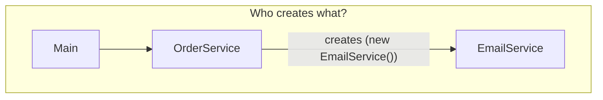
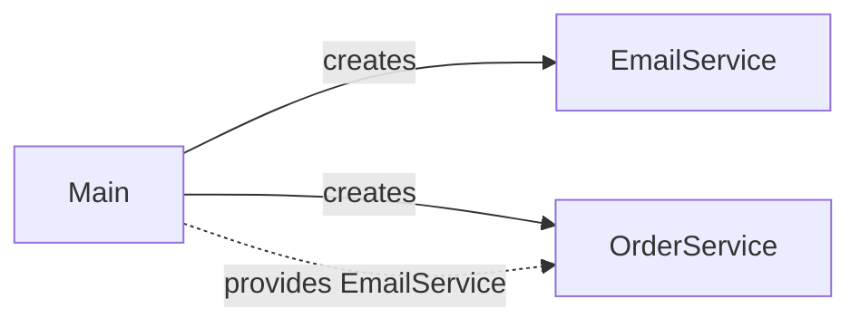
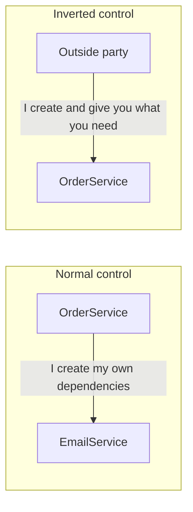
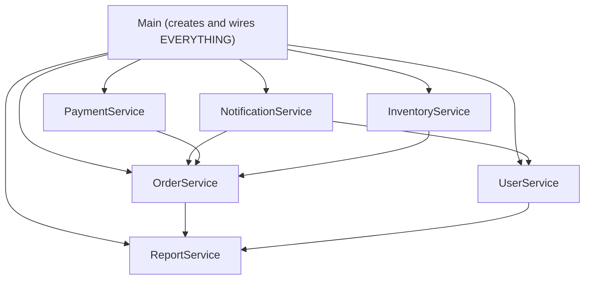

# Spring Lecture 4: Dependency Injection (DI) and Inversion of Control (IoC)

> [!abstract] What this lecture covers
> 1. The example project: a notification system (`OrderService` + notification services)
> 2. The problem: **tight coupling**
> 3. The solution: **loose coupling** using an interface
> 4. **Dependency Injection**, how it fixes the problem (constructor injection and setter injection)
> 5. **Inversion of Control (IoC)** and how it relates to DI
> 6. The new problem: `Main` becomes complex, and why Spring comes in
> 7. A short overview of Spring's IoC container (the detailed explanation is in Lecture 5)

> [!note] About the code in these notes
> The screenshots show the project structure, the `Main` class and the diagrams, but not the full source of `OrderService` and the notification classes. I wrote simple versions of them (including the `send(...)` method name) so the idea is clear. The structure, class names and the way `Main` wires things are exactly as in the lecture.

---

## 0. The Big Idea in One Line

> [!quote] The lecture's key sentence
> **A class should ask for what it needs and not build everything itself.**

Everything in this lecture is about that one sentence. Keep it in mind while reading.

---

## 1. The Example Project

The project is called `CoreDemo` (package `in.coderarmy`). We are building an **order system** that **sends a notification when an order is placed**.

```
in.coderarmy
 ├── Main
 ├── OrderService
 └── notification
      ├── NotificationService      (interface)
      ├── EmailService
      ├── FakeEmailService
      ├── SmsService
      └── PopUpNotificationService
```

| Class | Role |
|---|---|
| `OrderService` | Places an order and then sends a notification |
| `EmailService` | Sends the notification by email |
| `SmsService` | Sends the notification by SMS |
| `PopUpNotificationService` | Shows the notification as a pop-up |
| `FakeEmailService` | A fake email sender for testing (does not send real emails) |
| `NotificationService` | An **interface** that all of the above follow |
| `Main` | Starts the program |

### Key terms first

- **Dependency:** an object that another class **needs** to do its job.
  Here `OrderService` needs something to send notifications, so the notification service is a dependency of `OrderService`.
- **Coupling:** how strongly one class is **tied** to another class.
  - **Tight coupling:** the class is hard-wired to one specific class. Changing one forces changes in the other.
  - **Loose coupling:** the class depends only on a general contract (an interface), so the actual class behind it can be swapped easily.

---

## 2. Step 1: The Initial Design (Tight Coupling)

In the first design, `OrderService` **creates the `EmailService` object by itself**:

```java
public class OrderService {

    // OrderService builds its own dependency
    private EmailService emailService = new EmailService();

    public void placeOrder() {
        System.out.println("Order placed");
        emailService.send("Your order has been placed");
    }
}
```

`Main` just creates `OrderService` and uses it:

```java
public class Main {
    public static void main(String[] args) {
        OrderService order = new OrderService();
        order.placeOrder();
    }
}
```



This is the **"Initial Design"** from the lecture: `OrderService --creates--> EmailService`, and `Main --> OrderService`.

### Why is this a problem?

The `new EmailService()` line inside `OrderService` hard-wires it to `EmailService` **forever**. This causes several problems:

**Problem 1: Hard to change.**
Tomorrow the business says: "Send SMS instead of email." You must **open `OrderService` and edit it** (replace `EmailService` with `SmsService`). Now you must re-test `OrderService` even though order logic did not change. If you have 20 classes using `EmailService`, you edit all 20.

**Problem 2: Hard to test.**
You want to test `placeOrder()`. But it always creates a **real** `EmailService`, so every test would try to send real emails. You cannot replace it with `FakeEmailService`, because the class itself decides which one to use and you cannot reach inside.

**Problem 3: `OrderService` does too many jobs.**
It should only care about *placing the order*. But it also decides *which* notification class to use and *how to build it*. If `EmailService` later needs settings (server address, password), `OrderService` must also supply them. That is not its job.

**Problem 4: Low reusability.**
`OrderService` can only ever work with email. It cannot be reused in a project that needs SMS or pop-ups.

> [!important] The root cause
> The `new` keyword inside the class. When a class creates its own dependencies with `new`, it is **tightly coupled** to them.

---

## 3. Step 2: Make It Loosely Coupled (Use an Interface)

To loosen the coupling we need two changes. **Both are necessary.**

### Change 1: Depend on an interface, not on a concrete class

An **interface** is a contract that says *what* can be done, not *how*.

```java
public interface NotificationService {
    void send(String message);
}
```

Every notification class follows this contract:

```java
public class EmailService implements NotificationService {
    @Override
    public void send(String message) {
        System.out.println("Email sent: " + message);
    }
}

public class SmsService implements NotificationService {
    @Override
    public void send(String message) {
        System.out.println("SMS sent: " + message);
    }
}

public class PopUpNotificationService implements NotificationService {
    @Override
    public void send(String message) {
        System.out.println("Pop-up shown: " + message);
    }
}

public class FakeEmailService implements NotificationService {
    @Override
    public void send(String message) {
        System.out.println("Fake email (testing only): " + message);
    }
}
```

Now `OrderService` can say: *"I need **some** `NotificationService`. I do not care which one."*

```java
public class OrderService {

    private NotificationService notification;   // the interface, not EmailService

    // ... how does this get its value? See Change 2
}
```

### Change 2: Do not create the dependency inside the class. Receive it from outside.

If `OrderService` still wrote `notification = new EmailService()`, it would be tightly coupled again, even with the interface. So `OrderService` must **not** build it. It must **ask for it**, and someone else gives it.

That "giving from outside" is exactly what **Dependency Injection** is.

---

## 4. Step 3: Dependency Injection (DI)

### Definition

> **Dependency Injection** means that a class does **not create** the objects it depends on. Instead, those objects are **given (injected) to it from outside**.

- "Dependency" = the object the class needs
- "Injection" = handing it over from outside, instead of creating it inside

**Real-life analogy:** a chef in a restaurant. A tightly coupled chef grows his own vegetables, makes his own gas cylinder and builds his own stove before cooking. A loosely coupled chef just says "I need vegetables and a stove" and the restaurant supplies them. The chef focuses on cooking. If the restaurant changes the supplier, the chef's work does not change.

### Types of DI shown in the lecture

There are two ways to inject the dependency into `OrderService`.

### 4.1 Constructor Injection

The dependency is passed through the **constructor**.

```java
public class OrderService {

    private NotificationService notification;

    // The dependency arrives here
    public OrderService(NotificationService notification) {
        this.notification = notification;
    }

    public void placeOrder() {
        System.out.println("Order placed");
        notification.send("Your order has been placed");
    }
}
```

`Main` now does the wiring:

```java
public class Main {
    public static void main(String[] args) {

        NotificationService notification = new FakeEmailService();   // 1. create the dependency
        OrderService order = new OrderService(notification);         // 2. inject it
        order.placeOrder();                                          // 3. use it
    }
}
```

This is exactly the code in the lecture's `Main`.

**Now the magic: change behaviour without touching `OrderService`.**

```java
// Use pop-up instead
NotificationService notification = new PopUpNotificationService();
OrderService order = new OrderService(notification);
order.placeOrder();
```

Only **one line in `Main`** changed. `OrderService` was **not touched at all**. The same works for `EmailService`, `SmsService` or `FakeEmailService` (for testing).

### 4.2 Setter Injection

The dependency is passed **after** the object is created, through a **setter method**.

```java
public class OrderService {

    private NotificationService notification;

    // The dependency arrives here
    public void setNotification(NotificationService notification) {
        this.notification = notification;
    }

    public void placeOrder() {
        System.out.println("Order placed");
        notification.send("Your order has been placed");
    }
}
```

`Main`:

```java
NotificationService notification = new EmailService();

// OrderService order = new OrderService(notification);   // constructor way (commented out)

OrderService order = new OrderService();                   // create the object first
order.setNotification(notification);                       // then inject the dependency
order.placeOrder();
```

This is the code from the lecture where the constructor line is commented out and `setNotification(...)` is used.

### Constructor vs Setter: quick comparison

| | Constructor Injection | Setter Injection |
|---|---|---|
| When is it injected? | While creating the object | After creating the object |
| Is the dependency guaranteed? | **Yes.** You cannot create the object without it | **No.** You can forget to call the setter |
| Risk | Very low | `NullPointerException` if the setter is never called |
| Can it be changed later? | Not easily | Yes, call the setter again |
| Best for | **Required** dependencies | **Optional** or changeable dependencies |

> [!tip]
> If a class cannot work without a dependency, use constructor injection. It forces the caller to provide it, so the object is never half-ready.

---

## 5. Before vs After Dependency Injection

This is the diagram from the lecture, explained.

### Before DI (Initial Design)


- `OrderService` creates `EmailService` itself
- `OrderService` is tied to one specific class

### After DI



- **`Main` creates `EmailService`**
- **`Main` creates `OrderService`**
- **`Main` provides (injects) `EmailService` into `OrderService`**
- `OrderService` no longer creates anything. It simply **uses** what it was given

### The shift in responsibility

| | Before DI | After DI |
|---|---|---|
| Who creates `EmailService`? | `OrderService` | `Main` |
| Who decides which notification to use? | `OrderService` (hard-coded) | `Main` (can change anytime) |
| `OrderService` depends on | A concrete class (`EmailService`) | An interface (`NotificationService`) |
| Coupling | Tight | **Loose** |

### What we gained

1. **Flexibility:** swap Email / SMS / Pop-up by changing one line in `Main`
2. **Easy testing:** inject `FakeEmailService` in tests, so no real emails are sent
3. **Cleaner classes:** `OrderService` only handles orders
4. **Reusability:** `OrderService` works with any `NotificationService`, now or in the future
5. **Less breakage:** adding a new notification type (e.g. `WhatsAppService`) requires **no change** to `OrderService`

---

## 6. Inversion of Control (IoC)

### The meaning of the name

**Control** here means **the control of creating and connecting objects**.

- **Before:** `OrderService` was **in control**. It decided what to create and when (`new EmailService()`).
- **After:** `OrderService` gave up that control. **Someone else** (`Main`) now decides which object to create and gives it.

The control has been **inverted (reversed)**: from the class itself, to an outside party. That is **Inversion of Control**.



> [!note] This is the lecture's key sentence again
> *A class should ask what it needs and not build everything itself.* That is IoC in plain words.

### The relationship between IoC and DI

| | What it is |
|---|---|
| **IoC** | An **idea / principle**: "do not control your own dependencies, let someone else do it" |
| **DI** | An **approach / technique** to **achieve** IoC: "give the dependencies from outside" (constructor or setter) |

So:
- IoC is the **goal** (the *what*)
- DI is **one way to reach that goal** (the *how*)

> [!important] Remember
> **IoC is the principle. DI is the technique used to achieve it.**
> Every time you use DI you are following IoC. But IoC is the bigger idea.

---

## 7. The New Problem: `Main` Becomes Complex

Up to now **we** did the wiring manually inside `Main`. For one service this is fine:

```java
NotificationService notification = new EmailService();
OrderService order = new OrderService(notification);
```

But a real application has **many services**, and each one has its own dependencies. For example (illustrative):

```java
public static void main(String[] args) {

    NotificationService notification = new EmailService();
    PaymentService payment = new CardPaymentService();
    InventoryService inventory = new InventoryService();
    ShippingService shipping = new ShippingService();
    DiscountService discount = new DiscountService();
    // ... and more and more ...

    OrderService order = new OrderService(notification, payment, inventory, shipping, discount);
    UserService user = new UserService(notification);
    ReportService report = new ReportService(order, user);
    // ... and many more ...
}
```

### What goes wrong

- `Main` fills up with creation and wiring code. It becomes **long, messy and hard to read**
- You must keep the **correct order**: a dependency must be created before the object that needs it
- One service's dependencies may need their own dependencies, forming a **chain**, and you must build it all by hand
- When a constructor changes, you must **hunt down and edit `Main`**
- `Main` slowly turns into a "god class" that knows about everything



DI is a good idea, but doing it **by hand** does not scale. We need something that does the creating and wiring **automatically**.

---

## 8. This Is Where the Spring Framework Comes In

Spring takes over the job that `Main` was doing manually. The part of Spring that does this is called the **IoC Container**.

### Overview only (detailed explanation comes in Lecture 5)

> [!info] Scope of this lecture
> In Lecture 4 only the **overview** of the IoC container was given. How it really works (beans, how it finds and creates objects, how it injects them) is explained in **Lecture 5**, so those details are not covered here.

The **Spring Framework has an IoC Container**, and in short it does 3 jobs:

1. **Creates objects**
2. **Manages objects**
3. **Connects (wires) objects together**


So instead of `Main` doing all the `new` calls and wiring, we hand over this work to Spring. Our classes simply say what they need, and Spring supplies it. This is IoC in action, with Spring playing the "outside party".

---

## Quick Revision

- [ ] **Dependency** = an object a class needs to do its job
- [ ] **Tight coupling** = a class creates its dependency with `new` and is hard-wired to one concrete class
- [ ] Tight coupling problems: hard to change, hard to test, class does too much, low reusability
- [ ] **Loose coupling** = depend on an **interface**, and receive the object from outside
- [ ] Two required changes: (1) use an interface, (2) do not create the dependency inside
- [ ] **Dependency Injection** = giving a class its dependencies from outside instead of creating them inside
- [ ] **Constructor injection** = dependency passed via constructor (for required dependencies, always set)
- [ ] **Setter injection** = dependency passed via setter (for optional ones, risk of `null` if forgotten)
- [ ] After DI: `Main` creates `EmailService`, creates `OrderService`, and provides `EmailService` to it
- [ ] Switching Email, SMS, Pop-up or Fake needs **no change in `OrderService`**
- [ ] **IoC** = control of creating and wiring objects is taken from the class and given to someone else
- [ ] **IoC is the principle; DI is the technique** to achieve it
- [ ] Manual wiring in `Main` becomes complex when there are many services
- [ ] **Spring's IoC Container** creates, manages and connects objects (details in Lecture 5)

## Possible Exam / Interview Questions

1. What is a dependency? Give an example.
2. What is tight coupling? Why is it a problem? Give an example.
3. How do we achieve loose coupling?
4. What is Dependency Injection? Explain with the notification example.
5. What are constructor injection and setter injection? Compare them.
6. Why is constructor injection preferred for required dependencies?
7. What is Inversion of Control? What is being "inverted"?
8. What is the relationship between IoC and DI?
9. What problem occurs if we do all wiring manually in `Main`?
10. What are the 3 jobs of Spring's IoC container (overview)?

## Next Topics

- [[Spring IoC Container]] (Lecture 5)
- [[Beans]]
- [[Spring Initializr]]
